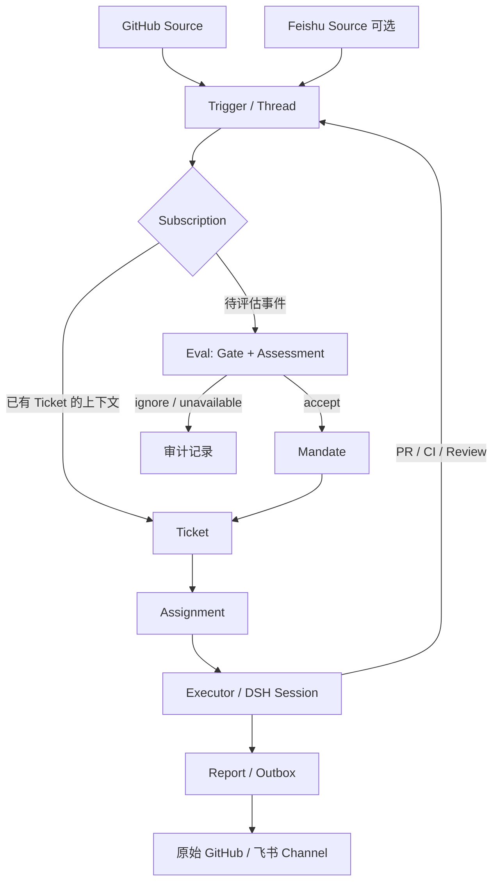

> **仓库**：[deepseek-ai/dsh-superagent-prototype](https://github.com/deepseek-ai/dsh-superagent-prototype) · TypeScript · MIT · 研究原型。
>
> **阅读结论：9.2/10，强烈推荐。** 优先学习它如何定义“授权工作”、让长期任务跨 Session 存活，以及让 Agent 在正确的时间打扰人。
>
> **范围说明：** 以下以公开仓库的 README、编号设计文档、配置为依据。README 明确表示这是供参考的研究原型，与内部实现及研究文章存在差异；部分论文设想尚未进入公开代码。文中“建议”“可借鉴”属于工程分析。

## 一、为什么值得读：Agent 从一次对话走向团队成员

常见 Coding Agent 从一个用户请求开始，执行工具调用，然后交付结果。团队级 Agent 还要处理三个持续存在的问题：

1. **谁能发起工作？** GitHub Issue、PR 评论、CI 通知和飞书消息的可信度与授权强度不同。
2. **任务如何长期存在？** 一个 PR 可能经历编码、Review、补充修改、CI 失败和再次 Review；其生命周期长于单次模型调用。
3. **什么时候应该打扰人？** Agent 的通知、确认和面板都在消耗团队注意力。

dsh-superagent 将自己包装为 [DeepSeek Harness](https://www.deepseek.com/en/harness/) 的 Bundle，监听单个 GitHub 仓库，也可接入飞书。获授权的请求会转成 Ticket，分配独立执行 Session 和工作目录，最终通过原始会话回复结果，例如提交 PR。

它在 [Philosophy](https://github.com/deepseek-ai/dsh-superagent-prototype/blob/main/docs/000-philosophy.md) 中提出一条鲜明的产品原则：

> Take as little human attention as possible, and give as much value as possible.

这条原则贯穿授权、消息、任务面板、配置和安装流程。

## 二、整体架构：事件进入领域系统，执行交给 Worker



Source 负责翻译外部平台事件，Engine 负责领域状态变更，Executor 负责真正执行，Channel 负责回复。这个分层使新增 Source 时可以保留相同的任务语义。

**源码入口：** [Architecture](https://github.com/deepseek-ai/dsh-superagent-prototype/blob/main/docs/007-architecture.md)、[src/core/engine.ts](https://github.com/deepseek-ai/dsh-superagent-prototype/blob/main/src/core/engine.ts)、[src/app/runtime.ts](https://github.com/deepseek-ai/dsh-superagent-prototype/blob/main/src/app/runtime.ts)。

## 三、领域模型：最有学习价值的部分

[001 Domain Model](https://github.com/deepseek-ai/dsh-superagent-prototype/blob/main/docs/001-domain.md) 对每个概念给出了明确的规则和存在理由。

| 概念 | 作用 | 工程意义 |
| --- | --- | --- |
| Source | GitHub、飞书等事件来源，维护读取位置和 Bot 身份 | 接入层可替换 |
| Trigger | 不可变事件，携带来源与发送者 | 幂等和审计的基本单位 |
| Thread | 一组有时间顺序的 Trigger | 串行评估，避免并发判断冲突 |
| Eval | 对候选请求进行 Gate 和模型 Assessment | 准入判断与业务执行分离 |
| Policy | 带版本的规则、允许列表、接单模式 | 规则变更可追踪 |
| Mandate | 一次接单授予的范围、强度和规则依据 | 授权边界明确 |
| Ticket | 一项被授权的工作 | 长期业务生命周期 |
| Assignment | Ticket 与某次 Executor 的绑定 | 可重试、恢复、替换执行器 |
| Subscription | Ticket 对 Thread 的订阅 | 后续评论自动进入原任务 |
| Channel | 将结果写回原始会话 | 保持沟通闭环 |

### 3.1 Ticket 与 Assignment 为什么要分开？

一个 Ticket 可以经历多次 Assignment：

```text
Ticket #42：修复登录异常
  ├─ Assignment A：启动编码 → 进程中断
  ├─ Assignment B：恢复 → 提交 PR
  └─ Assignment C：收到 Review → 修改并更新 PR
```

Ticket 保存任务的业务含义和授权依据；Assignment 记录当前由谁执行、执行到哪一步。仓库明确规定 Ticket 状态独立于 DSH Session 状态。

**值得复用：** 数据模型至少保留 `ticket_id`、`assignment_id`、`status`、`mandate_id` 和事件日志。这样可以支持 Agent 重启、人工接管、模型切换及故障重试。

### 3.2 Subscription 为什么重要？

假设 Agent 在 Issue #12 接到任务，随后创建 PR #30。Review 评论、CI 结果和补充讨论都可能与同一 Ticket 有关。Subscription 将这些 Thread 的后续 Trigger 作为上下文送到 Ticket。

特别关键的是：**订阅带来上下文，Mandate 决定执行权限。** 外部评论能够让 Agent 获得新事实，但不能自动扩大原任务的授权范围。

系统还区分 *context-only* 订阅：它可以提供证据，却不能让该线程的消息直接获得任务续办权限。这是对 Prompt Injection 与跨线程越权很有价值的设计。

## 四、Authorization：把权限落实在宿主程序

[002 Authorization](https://github.com/deepseek-ai/dsh-superagent-prototype/blob/main/docs/002-authorization.md) 将评估分成两层：

- **Gate：** 由宿主程序根据 Source、身份、允许列表、Policy 和接单模式执行确定性准入。
- **Assessment：** 模型根据候选事件、Thread 快照、历史 Ticket 与规则判断是否接单。

Decision 包括 `accept`、`stop`、`ignore`、`unavailable`。接受请求时创建不可变 Mandate，记录 Policy 版本、授权范围、授权强度、匹配规则及事件来源。

### Explicit 与 Inferred

显式请求通常是允许列表中的人直接 @Agent；推断候选可以来自规则允许的消息或 Bot 事件。仓库的默认主动接单模式为 `observe`：先观察和记录候选，再决定是否开放自动执行。

值得注意的细节：

- Policy 变更会通知相关运行中 Ticket；已授权任务有自己的 Mandate，结束后恢复时会重新验证。
- 外部消息、引用文档和评论属于输入数据，无法改写宿主程序强制执行的权限。
- Executor 遇到超出 Ticket 范围的后续请求，可以 hand back 给主 Session 重新评估。

**实践建议：** 把 `canStartTask(actor, source, policy)` 和 `canPerform(ticket, action, mandate)` 做成可测试的宿主层能力。模型负责理解意图，权限校验由确定性代码执行。

## 五、Runtime：让 Agent 任务具备恢复能力

[003 Execution](https://github.com/deepseek-ai/dsh-superagent-prototype/blob/main/docs/003-execution.md) 与 [007 Architecture](https://github.com/deepseek-ai/dsh-superagent-prototype/blob/main/docs/007-architecture.md) 是实现层的核心。

### 5.1 Engine + Ports + Effects

`Engine` 是 Trigger、Thread、Decision、Ticket 和 Assignment 的唯一写入入口。其同步方法在事务中修改领域数据，并将外部副作用排入队列；Effects 在事务提交后执行。Outbox 将发送意图与回执持久化。

```text
Source 收到 GitHub 评论
  → Engine.receive(trigger)
  → 事务：去重、存 Trigger、更新 Thread、分发 Input
  → 提交
  → Effects：唤醒 Session / 发送消息
  → Outbox：记录回执
```

这样可以针对重试、进程中断和消息重复送达建立清晰的恢复规则。实现时仍需要外部接口的幂等键及失败重试策略。

### 5.2 Worker Slot 与后台任务

每个 Ticket 分配独立 DSH Session 和工作目录。前台 Shell 超过 5 秒会转为后台任务，避免长命令阻塞新消息；后台任务结束后可唤醒 Worker。

并发控制还有一个实用设计：**保留额外的人工交互名额**。即使普通 Worker 槽位占满，人的消息或状态查询仍有机会及时处理。

### 5.3 恢复与任务阶段

仓库将任务显示状态定义为“正在等待什么”：排队、工作中、等待 Trigger、等待回答、等待 Review、阻塞、失败、输入投递失败等。状态按可检验的条件推导，避免仅依靠模型的自由文本猜测。

恢复时，系统会检查中断的 Assignment、尚未读取的 Input、未完成的外部副作用，并为需要重新执行的任务附带恢复说明。

**工程启示：** 先保存任务状态与事件，再恢复模型执行。UI 的状态应该来自结构化领域事实。

## 六、Harness：Router 与 Worker 使用不同能力集

仓库通过 [cordis.patch.yml](https://github.com/deepseek-ai/dsh-superagent-prototype/blob/main/cordis.patch.yml) 定义两个 Session Preset：

| 角色 | 职责 | 能力范围 |
| --- | --- | --- |
| Router / Main Session | 评估、路由、通知、分派 | 更小的工具集合，文件操作偏只读 |
| Worker / Executor Session | 编码、测试、交付、回应 Review | 文件读写、Shell、Jobs、Skills、Subagents |

Router 的 Prompt 专注路由决策，Worker 负责技术实现与验证。这种职责分离能降低主 Session 的上下文负担，也让工具权限与任务职责相匹配。

[004 Prompts](https://github.com/deepseek-ai/dsh-superagent-prototype/blob/main/docs/004-prompts.md) 还展示了 Prompt 工程的进阶形式：

1. 系统 Prompt 分为共享规则、角色、团队要求、订阅/回复、工作指令、交接、环境和 Policy 等部分。
2. 团队可以覆盖内置部分，系统保留原始版本和修订历史。
3. 保存时基于修订号检测冲突；升级时可以比较旧默认值、新默认值和团队自定义文本。
4. Session 会记录实际使用的 Prompt 修订。

这为排查“为什么同一个 Agent 本周行为变了”提供了可追溯依据。

## 七、交互设计：只展示需要人处理的事情

[005 Panel](https://github.com/deepseek-ai/dsh-superagent-prototype/blob/main/docs/005-panel.md) 提出三个优先级：

1. 现在有什么需要我处理？
2. 系统是否健康、是否在做正确的事？
3. 一项任务从 Trigger、Eval 到 Ticket 的历史是什么？

面板按照 Overview、Source、Trigger、Eval、Execution、Settings 分区。Overview 优先呈现待回答、待 Review、阻塞和失败任务；健康状态保持低存在感。详情页则展示授权来源、Policy 版本、Assignment、Input、Subscription 与重试入口。

这一点对 Agent 平台尤其重要：**交互应围绕“下一步需要谁行动”组织，而不是堆叠运行日志和状态标签。**

例如，一张待审核任务卡片最重要的字段是任务目标、变更结果、测试证据、风险和“审核 / 继续 / 停止”操作。Token、耗时、Session ID 等可以放在二级详情。

## 八、工程边界：研究原型的安全与部署限制

公开文档明确说明 Worker 以操作系统用户身份执行命令，默认无需逐次批准。目录隔离、命令黑名单和 CLI 包装器主要用于组织与约束默认行为；它们本身不构成强安全边界。执行器仍可能通过绝对路径调用程序。

因此在真实团队部署时，建议额外配置：

- 专用低权限执行身份、容器或沙箱，以及网络与文件系统边界。
- GitHub 最小权限账户、分支保护、必需 Review 与 CI 检查。
- 关键外部写操作的宿主级授权、审计记录和人工确认。
- 幂等事件消费、Outbox 重试与失败告警。

仓库 [SETUP.md](https://github.com/deepseek-ai/dsh-superagent-prototype/blob/main/SETUP.md) 本身也值得参考：先探测环境，再逐个询问必要配置，统一展示执行计划并等待确认；账号登录和密钥输入由用户在自己的终端完成。

## 九、放入 Agent Engineering 知识图的哪个位置？

建议新增 **Autonomous Workflow / Orchestration（自主工作流与编排）**，连接以下能力层：

| 能力层 | dsh-superagent 的对应设计 | 延伸学习 |
| --- | --- | --- |
| Harness | DSH Bundle、Router/Worker Preset、Prompt 版本 | [DeepSeek Harness](https://www.deepseek.com/en/harness/) |
| Authorization | Gate、Policy、Mandate | 最小权限、Prompt Injection 边界 |
| Runtime | Ticket/Assignment、Session、Effects、恢复 | [Orca](https://github.com/stablyai/orca) |
| Control Plane | Ticket、Approval、管理面板 | [Paperclip](https://github.com/paperclipai/paperclip) |
| Context / Memory | Thread、Subscription、context-only | [Hindsight](https://github.com/vectorize-io/hindsight) |
| Provenance / Evaluation | Trigger、Decision、Policy/Prompt 版本、Report | [REA](https://github.com/morluto/rea) |

它与基础 Harness 的关系可以理解为：Harness 提供 Session、工具和运行能力；Superagent 在其上建立团队级事件、授权、任务和交付工作流。与偏重多任务工作区的 Orca、偏重组织管理的 Paperclip 相比，它尤其突出**消息驱动的持续任务与授权语义**。

## 十、如何做一个最小可运行版本？

建议先做一个 `GitHub Issue → Agent → Draft PR` 的 TypeScript 原型，保留最关键的领域概念。

### 最小数据结构

```ts
type Trigger = {
  id: string;
  source: "github";
  threadId: string;
  actor: string;
  payload: unknown;
};

type Mandate = {
  id: string;
  policyVersion: string;
  scope: string;
  strength: "explicit" | "inferred";
  grantedBy: string;
};

type Ticket = {
  id: string;
  mandateId: string;
  state: "open" | "ended";
  latestAssignmentId?: string;
};

type Assignment = {
  id: string;
  ticketId: string;
  state: "pending" | "running" | "ended";
  sessionId?: string;
};
```

这是便于教学的简化模型，真实项目还需要 Source、Thread、Decision、Subscription、Input、Report、Outbox 等结构。

### 五个验收用例

1. GitHub Webhook 重复投递：同一 Trigger 只产生一次业务接单。
2. 未授权用户评论：保留审计记录，不启动新的执行任务。
3. PR Review 到来：原 Ticket 收到新 Input，在授权范围内继续。
4. Worker 进程中断：重启后恢复任务，保留未消费的 Input。
5. Agent 需要决策：任务进入“等待人工”，面板展示明确操作。

### 学习安排

| 时间 | 阅读与实现 | 产出 |
| --- | --- | --- |
| 周六上午 | 精读 [001 Domain](https://github.com/deepseek-ai/dsh-superagent-prototype/blob/main/docs/001-domain.md) | ER 图、状态机、领域术语表 |
| 周六下午 | 精读 [002 Authorization](https://github.com/deepseek-ai/dsh-superagent-prototype/blob/main/docs/002-authorization.md) | Policy / Mandate 校验和单测 |
| 周日上午 | 精读 [003 Execution](https://github.com/deepseek-ai/dsh-superagent-prototype/blob/main/docs/003-execution.md) | Ticket / Assignment 与恢复逻辑 |
| 周日下午 | 阅读 [007 Architecture](https://github.com/deepseek-ai/dsh-superagent-prototype/blob/main/docs/007-architecture.md) | Engine + Effects + Outbox 最小 Demo |
| 下周 | 接 GitHub Webhook、Worker、React 面板 | 可演示的 Issue → Draft PR 闭环 |

## 最终判断

这个仓库最值得学习的贡献，是将 Agent 自治能力转化为**可描述、可授权、可恢复、可审计的工程系统**。尤其建议把 Mandate、Subscription、Ticket/Assignment 解耦和低打扰交互作为四个独立学习专题。

对于正在构建 Agent 平台的开发者，先实现小规模、权限明确、人工审核的 GitHub 工作流，再扩展到多 Source、主动规则与长期任务，会是更稳健的实践路径。

## 参考资料

- [项目 README](https://github.com/deepseek-ai/dsh-superagent-prototype)
- [000 Philosophy](https://github.com/deepseek-ai/dsh-superagent-prototype/blob/main/docs/000-philosophy.md)
- [001 Domain Model](https://github.com/deepseek-ai/dsh-superagent-prototype/blob/main/docs/001-domain.md)
- [002 Authorization](https://github.com/deepseek-ai/dsh-superagent-prototype/blob/main/docs/002-authorization.md)
- [003 Execution](https://github.com/deepseek-ai/dsh-superagent-prototype/blob/main/docs/003-execution.md)
- [004 Prompts](https://github.com/deepseek-ai/dsh-superagent-prototype/blob/main/docs/004-prompts.md)
- [005 Panel](https://github.com/deepseek-ai/dsh-superagent-prototype/blob/main/docs/005-panel.md)
- [007 Architecture](https://github.com/deepseek-ai/dsh-superagent-prototype/blob/main/docs/007-architecture.md)
- [SETUP](https://github.com/deepseek-ai/dsh-superagent-prototype/blob/main/SETUP.md)
