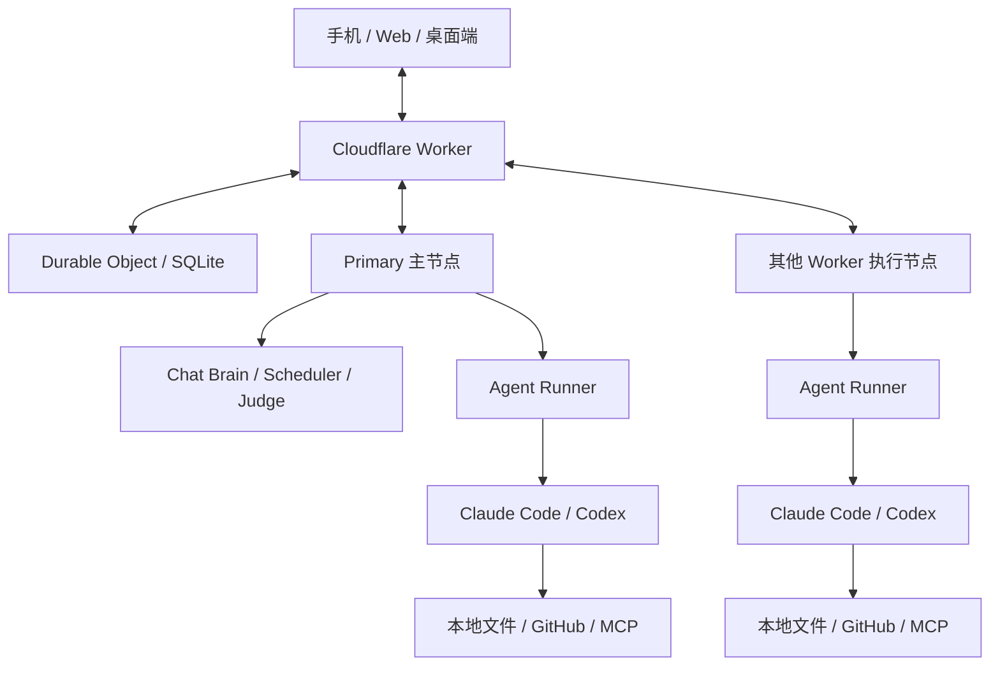
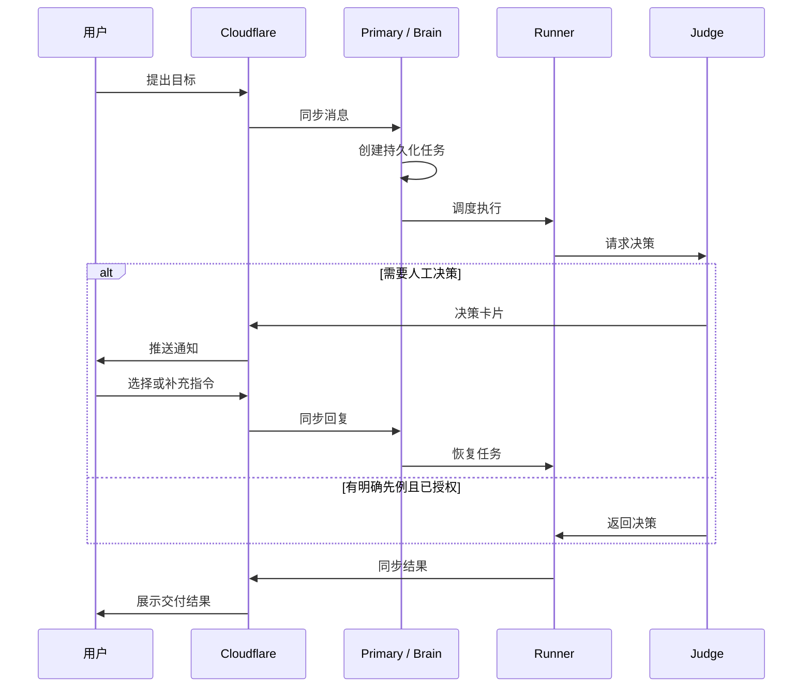
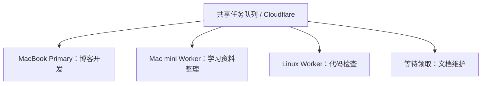
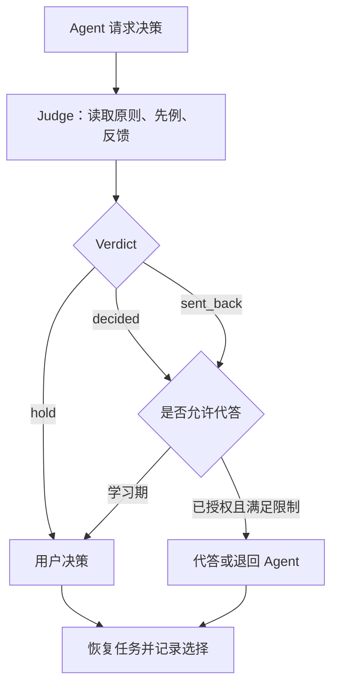
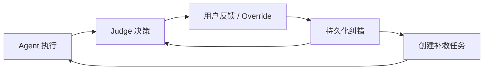
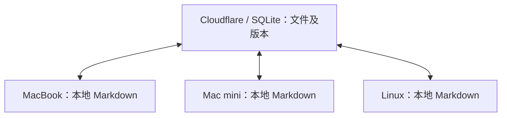

> **项目**：[huacnlee/noop](https://github.com/huacnlee/noop) · MIT · 自托管 AI 团队。
>
> **学习评价：9.0/10，强烈推荐。** 重点研究持续运行、多机调度和渐进式自主权。
>
> **范围：** 基于 README、架构文档及 autonomy.ts、decisions.ts 源码；流程图和业务案例为解释性示例，评估数据为模拟值。

## 一、Noop 解决什么问题？

Claude Code 和 Codex 提供理解任务、操作文件、调用工具和执行代码的能力。Noop 在这些成熟 Agent 的外层增加长期在线的协调系统，让用户提出目标，团队拆解工作、执行任务、汇报结果，并在关键节点请求决策。

它主要解决五个问题：

- 用户离开电脑后，任务如何持续推进？
- 多个 Agent 和多台机器如何共享工作？
- Agent 遇到问题时，如何判断是否需要询问用户？
- 如何积累用户偏好，逐步减少人工干预？
- 如何保存任务和决策，使工作跨进程、跨设备持续存在？

从 Agent Engineering 的分层来看，Noop 属于 Orchestration / Proactive Runtime 层，Claude Code、Codex 属于执行 Agent / Harness 层，Claude、GPT 等模型提供推理能力。

## 二、整体架构：云端协调，本地执行



| 层级 | 组件 | 职责 |
| --- | --- | --- |
| 客户端 | NSH Web、桌面及移动应用 | 对话、任务管理、审批 |
| 云端协调层 | Cloudflare Worker | API、身份认证、实时消息、通知 |
| 云端状态层 | Durable Object + SQLite | 文件版本、消息、任务状态、历史 |
| 主节点 | macOS / Linux Daemon | 理解用户意图、周期调度、Judge、执行 |
| 执行节点 | macOS / Linux / Windows | 领取符合能力要求的任务 |
| 执行层 | Claude Code / Codex | 推理、工具调用、实际工作 |

所有机器主动向云端发起 HTTPS 连接，无需开放本地入站端口。主节点需要持续在线；辅助节点上线时参与执行，离线时可以由其他满足条件的节点承担新任务。

官方说明 Cloudflare 免费套餐足以作为起点。模型订阅或 API、机器运行成本另计。

源码：[架构文档](https://github.com/huacnlee/noop/blob/main/docs/architecture.md)、[cloud/src/index.ts](https://github.com/huacnlee/noop/blob/main/cloud/src/index.ts)。

## 三、一个用户请求如何串起整个系统？

以个人技术博客维护为例，用户通过手机提出：“优化文章阅读体验，完成后提交 PR。”

1. 客户端将消息发送到 Cloudflare，进入主节点的 inbox。
2. 主节点接收消息，Chat Brain 使用本地 Claude CLI 的 Haiku 模型理解意图，并通过 Noop 内部工具创建、修改或分派任务。
3. 任务保存为 Markdown 文件，通过云端文件同步机制共享给执行节点。
4. 符合任务能力要求且有空余执行容量的机器领取任务。
5. Runner 构造 Prompt，注入任务、角色、规则与记忆，启动 Claude Code 或 Codex；负责人可以派生子 Agent。
6. 执行 Agent 修改代码、验证结果、提交 PR，或在需要判断时发起决策请求。
7. Judge 根据用户原则与历史决策判断是否可以代答；需要用户处理时发送通知。
8. 用户回复后，任务重新进入可执行队列，Agent 根据追加的决策继续工作。



后台 Daemon 的核心循环可简化为以下伪代码（用于解释架构）：

```ts
while (running) {
  await pull()
  await routines()
  await replies()
  await judge()
  await runTasks()
  await push()
}
```

| 源码 | 职责 |
| --- | --- |
| [brain.ts](https://github.com/huacnlee/noop/blob/main/src/brain.ts) | 用户意图与任务管理工具 |
| [cli.ts](https://github.com/huacnlee/noop/blob/main/src/cli.ts) | 持续运行、调度循环 |
| [core.ts](https://github.com/huacnlee/noop/blob/main/src/core.ts) | 文件、任务、领取、配置 |
| [runner.ts](https://github.com/huacnlee/noop/blob/main/src/runner.ts) | Prompt 构建和 Agent 执行 |
| [sync.ts](https://github.com/huacnlee/noop/blob/main/src/sync.ts) | 多节点文件同步 |
| [decisions.ts](https://github.com/huacnlee/noop/blob/main/src/decisions.ts) | 决策、恢复、纠错 |
| [autonomy.ts](https://github.com/huacnlee/noop/blob/main/src/autonomy.ts) | 自主权及影子评估 |
| [sessions.ts](https://github.com/huacnlee/noop/blob/main/src/sessions.ts) | 从历史会话学习用户偏好 |
| [medic.ts](https://github.com/huacnlee/noop/blob/main/src/medic.ts) | 运行故障修复 |

## 四、多机调度：分布式任务队列

假设有 MacBook、Mac mini 和 Linux 服务器，各自安装 Noop。MacBook 作为主节点负责调度和决策，也能执行任务；其他机器从共享队列领取任务。



每台机器同步共享文件，检查任务要求、本机能力和执行容量，然后尝试领取任务。多个节点可能同时看到同一项待办，因此必须处理竞争。

Noop 的文件提交使用 Compare-and-Swap（CAS），以路径和 base_version 作为版本校验依据。某台机器先提交成功后，另一台机器以旧版本提交会收到 HTTP 409，任务领取依赖这一机制避免重复认领。

这与 BullMQ 等系统的 Producer / Queue / Worker 模式有相似之处，但 Noop 的共享状态以文件为核心。CAS 保护领取竞争；外部副作用的端到端恰好一次执行仍需要额外的幂等策略。

任务状态可以跨运行保留：inbox、active、waiting、blocked、done 等。只使用一台电脑也可以运行，多机主要扩展并行度及环境适配能力。

## 五、核心设计：Graduated Autonomy（渐进式自主权）

Noop 将信任设计为可以积累、评估并由用户授予的能力。初期让 AI 先观察和预测用户决策，随着证据积累逐步提高自主程度。

源码定义三个等级：

| 等级 | 自发任务 | Judge 权限 |
| --- | --- | --- |
| onboarding | 通常需要审批；用户直接创建、已批准任务及部分只读例行任务有例外 | 影子判断，由用户实际选择 |
| assisted | 一般可以直接执行；可配置 followup 仍需批准 | 可以根据先例代答 |
| autonomous | 自发任务无需常规准入审批 | 可以根据先例代答 |

全局自主级别可以配置，Judge 的自主级别也支持按 Agent 覆盖。当前源码的任务准入函数 needsApproval 使用全局等级；单 Agent 覆盖主要体现在 Judge 决策权限。assisted 与 autonomous 的差异主要在自发 followup 的审批设置，两者都允许 Judge 按规则代答。

### 5.1 Shadow Judge：先预测，再授权

学习期的关键是让 Judge 在用户回答之前生成自己的判断，并记录下来。

例如博客维护 Agent 提出：

- A：更新全部依赖。
- B：只更新存在安全问题的依赖。
- C：维持现有版本。

Judge 预测 A，用户实际选择 B。系统可以记录两者不一致；如果执行 Agent 原本也建议 A，则用户选择与 Agent 推荐的差异还会进入 lessons.md。

之后遇到类似问题，Judge 可以参考这次决策。模型权重保持不变，学习通过持久化记忆、历史决策和 Prompt 注入完成。

### 5.2 Judge 的三种判断

Judge 的 Prompt 将输出约束为三个 verdict：

| Verdict | 含义 | 后续行为 |
| --- | --- | --- |
| decided | 已存在明确先例或原则 | 返回答案与依据 |
| sent_back | 问题信息不足、可自行调查或已有规则 | 退回执行 Agent |
| hold | 新判断、高风险或缺乏信心 | 请求人工决策 |



Sent Back 尤其值得学习。执行 Agent 如果提出“CI 为什么失败”，Judge 可以要求它先读取日志、调查原因。由此可以减少用户被可自行解决的问题打扰的次数。

学习期，routeDecision 会把 Judge 的非 hold 结果转为人工处理，同时保留原始预判。合并 PR 卡片另有明确的人工决策限制。

### 5.3 个性化 Eval：测量决策一致率

autonomy.ts 的 judgeAccuracy() 读取已关闭、由用户回答且存在影子评估记录的决策，统计有可比较结果的样本及一致率。它还记录 Judge 原本愿意直接决策的数量。

例如：

| 指标 | 模拟值 |
| --- | --- |
| 已评分决策 | 50 |
| 一致决策 | 46 |
| 一致率 | 92% |

这个例子仅用于说明机制。源码中的实际阈值及晋级策略需要结合负责提出晋级建议的 architect 进一步核实。晋级设计为根据指标提出建议、由用户决定。

一致率也有局限：choice() 主要归一化选项字母、数字或文本，因此选择相同选项并不代表推理正确。样本分布、风险等级、主动代答覆盖率和纠错率都值得在自己的系统中额外评估。

### 5.4 Override：把纠错变成后续工作

当 Judge 代答后，用户仍然可以纠正该决策。overrideJudge() 将原有结果和用户的新选择写入关闭的决策文件，同时追加到 memory/judge-feedback.md，并创建一个高优先级任务调整或撤销之前的工作。



Judge 下一次构造 Prompt 时会优先参考纠错记录。这让反馈同时影响当前任务的修复和未来的判断。

源码入口：[autonomy.ts](https://github.com/huacnlee/noop/blob/main/src/autonomy.ts)、[decisions.ts](https://github.com/huacnlee/noop/blob/main/src/decisions.ts)。重点阅读 judge()、routeDecision()、learn()、judgeAccuracy() 和 overrideJudge()。

## 六、Memory：Markdown 文件如何跨设备共享？

默认机器目录为 ~/.noop，可通过 NOOP_HOME 自定义。下面是围绕任务与记忆的简化目录：

```text
~/.noop/
├── noop.toml
├── data/
│   ├── memory/
│   │   ├── lessons.md
│   │   └── judge-feedback.md
│   ├── policies/
│   ├── decisions/
│   │   ├── open/
│   │   └── closed/
│   └── tasks/
│       ├── proposed/
│       ├── inbox/
│       ├── active/
│       ├── waiting/
│       ├── blocked/
│       ├── done/
│       └── rejected/
├── memory-snapshots/
├── sync.json
└── sync-base/
```

Markdown 文件既能保存任务正文，也能通过 frontmatter 保存任务 ID、Agent、来源、状态以及决策引用等结构化信息。

每台机器维护本地 DATA 镜像。Agent 可以通过熟悉的文件读写方式操作任务与记忆，sync.ts 负责与 Cloudflare Worker 同步。Durable Object 中的 SQLite 保存云端文件版本和历史；官方架构文档描述了 90 天 / 2 万行的历史保留策略，每个路径的最新版本始终保留。本地记忆快照保留最近 14 天的副本。



Judge 构造 Prompt 时读取 memory、policies、最近 60 条先例及 judge-feedback.md 的尾部内容，并附上当前问题、建议与选项。这套决策记忆无需向量数据库即可工作；随着数据增长，可以进一步研究按任务类型检索相关先例、记忆压缩和过期策略。

## 七、交互设计：让用户只处理真正需要他的事情

Noop 的产品重点是把用户注意力集中在结果和决策上。

一张决策卡片可以包含问题、当前上下文、可选答案、推荐项及相关附件。等待用户时，任务以持久化状态暂停；回答后追加决策并重新排队。自发任务还可以批量询问用户，减少逐条审批。

对于个人 AI 团队来说，重要的 UX 是清楚展示下一步需要谁行动、为什么需要决策，以及回答后会发生什么。详细运行日志可以作为二级诊断信息。

## 八、工程启发与学习路径

| 能力层 | Noop 的实现 | 可复用思路 |
| --- | --- | --- |
| Runtime | Daemon、持久化任务 | 跨会话调度与恢复 |
| Orchestration | Brain、Runner、多机协作 | 意图路由与执行解耦 |
| Evaluation | Shadow Judge | 面向个人偏好的在线评估 |
| Autonomy | 三级自主权 | 以证据和授权逐步扩大决策范围 |
| Memory | Markdown、历史决策 | 可读、可编辑、可同步的记忆 |
| Human-in-the-loop | 决策卡片、Override | 人工反馈与补救任务闭环 |

自主判断与执行权限需要独立管理。项目另有 gates.ts 为合并、发布等操作增加限制；这些限制的覆盖范围需结合实际执行器验证。

与 [DeepSeek Superagent](https://github.com/deepseek-ai/dsh-superagent-prototype) 对照学习也很有价值：Superagent 侧重团队工作事件、授权与 Ticket 生命周期；Noop 侧重个人决策偏好、渐进式授权与跨设备执行。

建议按以下顺序进行源码学习：

1. 阅读 architecture.md，建立整体分层认知。
2. 串联 brain.ts、cli.ts、runner.ts，跟踪一个用户请求的生命周期。
3. 阅读 core.ts、sync.ts，理解任务领取与文件同步。
4. 深入 decisions.ts、autonomy.ts，实现最小 Shadow Judge。
5. 用真实决策样本评估一致率、主动代答覆盖率和纠错率，最后引入人工确认的分级授权。

最值得借鉴的组合是 **Shadow Mode + Personalized Eval + Graduated Autonomy + Feedback Loop**。这让长期运行的 Agent 具备可观察、可评价、可纠正的决策学习过程。

## 参考资料

- [Noop GitHub 仓库](https://github.com/huacnlee/noop)
- [项目官网](https://huacnlee.github.io/noop/)
- [官方架构文档](https://github.com/huacnlee/noop/blob/main/docs/architecture.md)
- [MCP 文档](https://github.com/huacnlee/noop/blob/main/docs/mcp.md)
- [渐进式自主权源码](https://github.com/huacnlee/noop/blob/main/src/autonomy.ts)
- [决策学习源码](https://github.com/huacnlee/noop/blob/main/src/decisions.ts)
